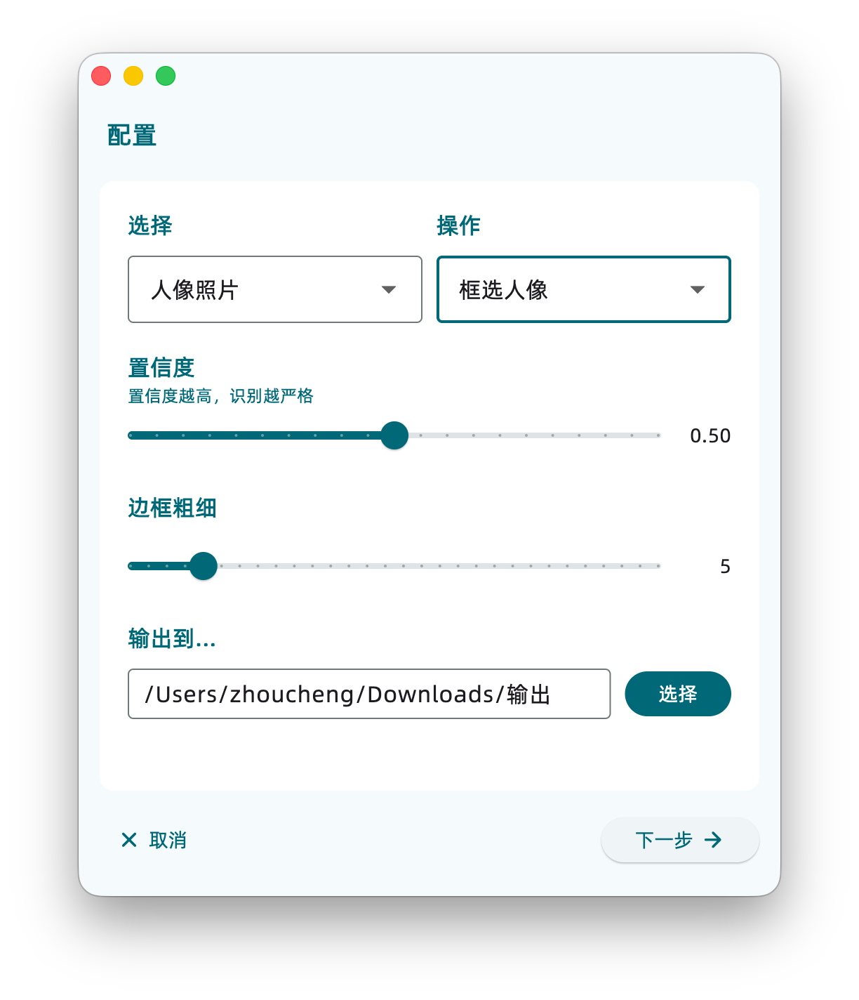
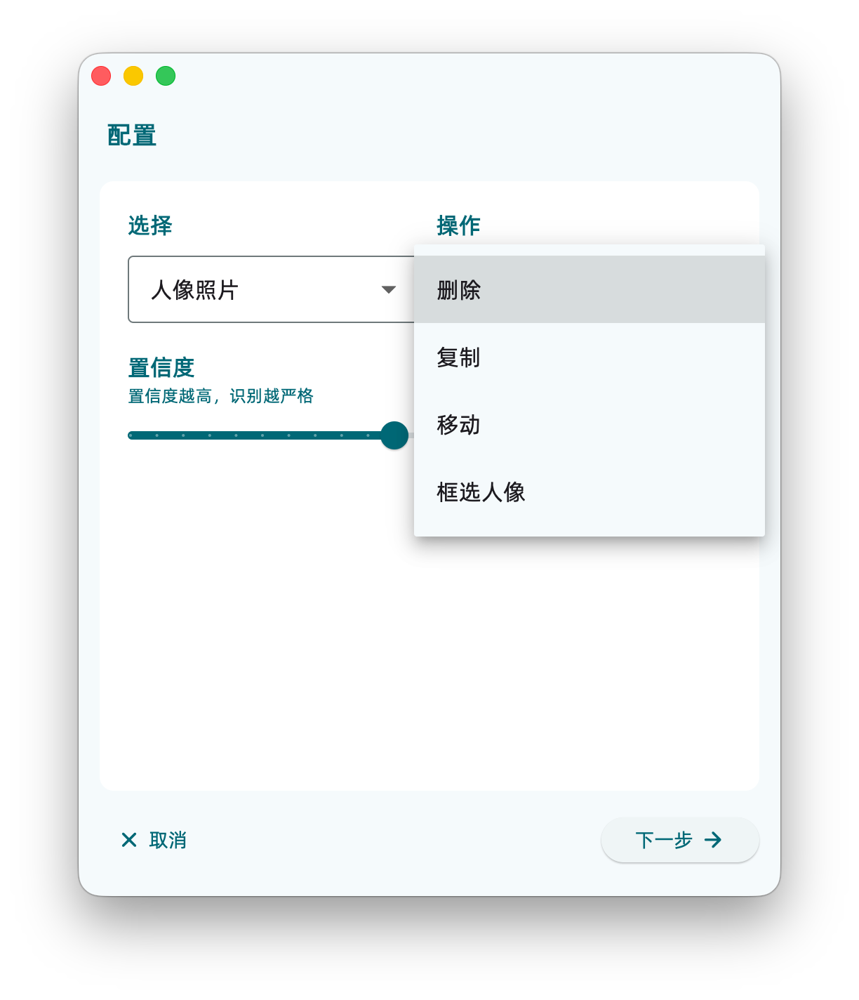

# FaceDetector

Also available in English. Click [HERE](/documents/en.md) to view the English version of the README

## 简介


<a href="https://apps.microsoft.com/detail/9pmcvnr610td?referrer=appbadge&mode=direct">
	
</a>

这是一个人脸检测的工具，支持
- 复制/移动/删除 人像照片/非人像照片 到某个目录
- 框选照片中的人像
- 修改置信度（判定严格程度）

核心模块[在这里](https://github.com/Zhoucheng133/Face-Detector)使用Python开发

## 截图




## 在你的设备上构建

- 前往[Google AI Edge](https://developers.google.com/edge/mediapipe/solutions/vision/face_detector#models)中下载模型，Relase的版本使用的是`BlazeFace (full-range)`
- 前往[核心组件仓库](https://github.com/Zhoucheng133/Face-Detector)构建二进制文件，详细见其README文档。构建的`detector.exe`（Windows）或者`detector`（macOS）移动到本项目的`windows`和`macos`文件夹中
- 使用Flutter构建完成的App，注意Flutter版本不要低于`3.41.6`
	```bash
	# Windows
	flutter build windows

	# macOS
	flutter build macos
	```