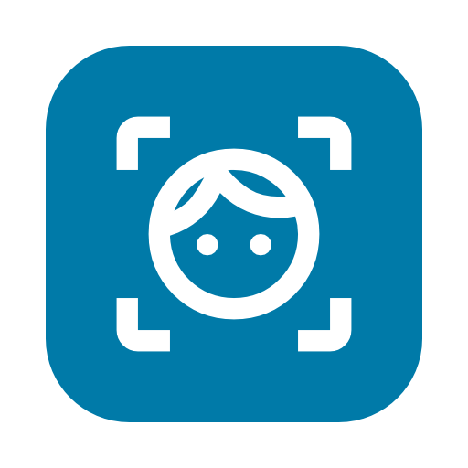
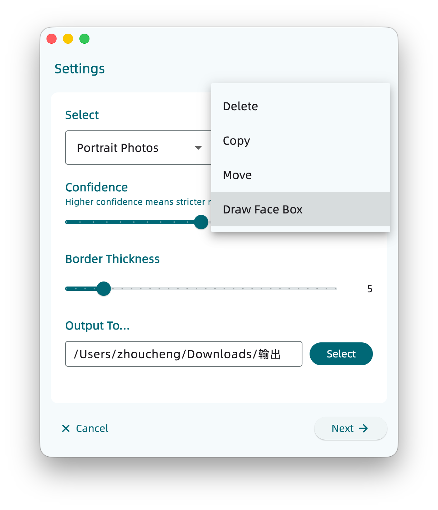
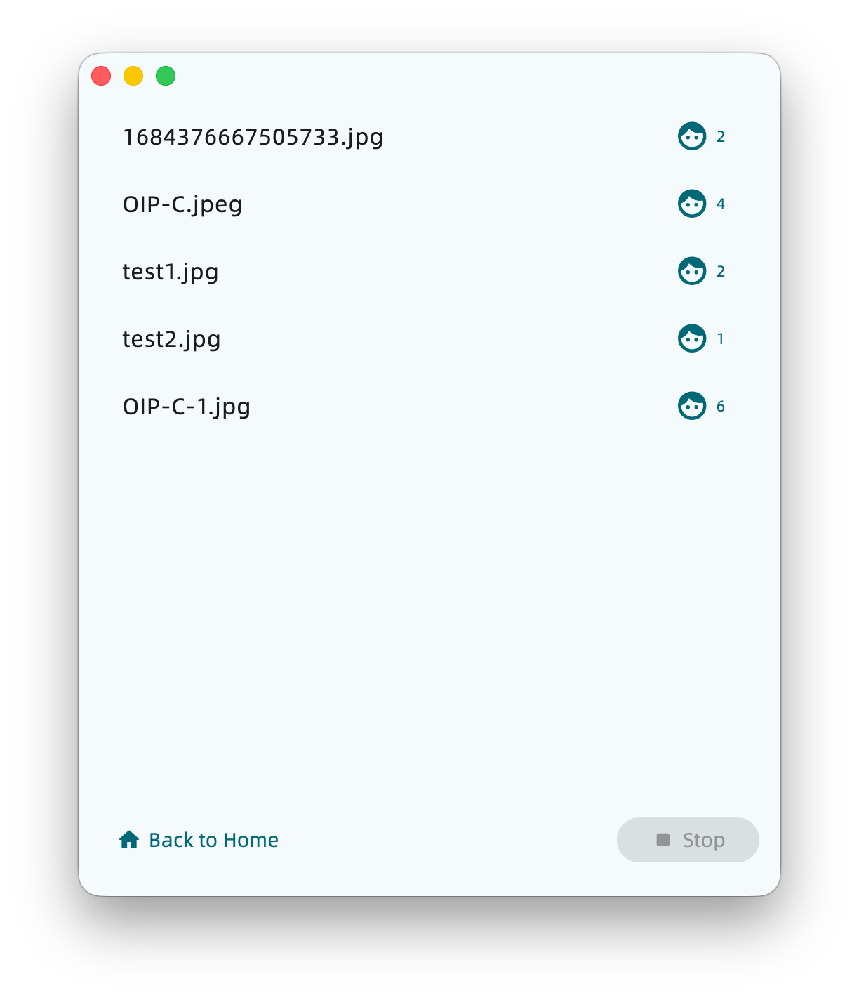

# FaceDetector

Chinese version is available. Click [HERE](../README.md) to view the Chinese version of the README.

## Introduction




<a href="https://apps.microsoft.com/detail/9pmcvnr610td?referrer=appbadge&mode=direct">
	
</a>

This is a face detection tool that supports:
- Copying/moving/deleting portrait photos/non-portrait photos to a certain directory
- Drawing bounding boxes around faces in photos
- Adjusting the confidence threshold (detection strictness)

The core module is developed in Python [HERE](https://github.com/Zhoucheng133/Face-Detector)

## Screenshots




## Build on Your Device

- Go to [Google AI Edge](https://developers.google.com/edge/mediapipe/solutions/vision/face_detector#models) to download the model. The Release version uses `BlazeFace (full-range)`
- Go to the [core component repository](https://github.com/Zhoucheng133/Face-Detector) to build the binary. See its README for details. Move the built `detector.exe` (Windows) or `detector` (macOS) to the `windows` and `macos` folders of this project
- Build the app with Flutter. Make sure the Flutter version is not lower than `3.41.6`
	```bash
	# Windows
	flutter build windows

	# macOS
	flutter build macos
	```
